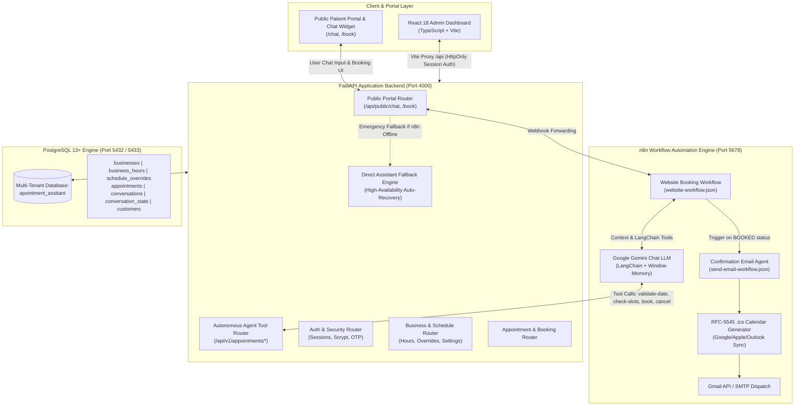
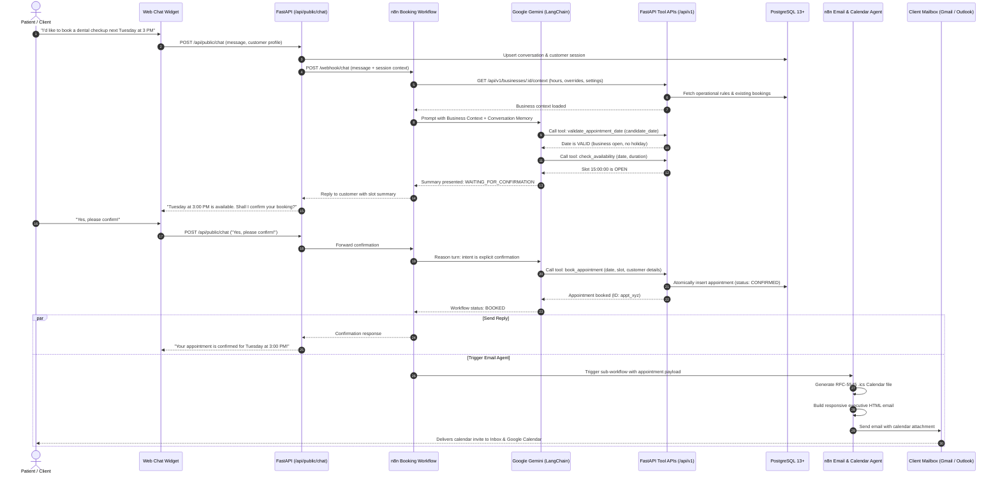

# AI Appointment Assistant — Multi-Tenant Dashboard & Automation Engine

[](https://fastapi.tiangolo.com/)
[](https://react.dev/)
[](https://www.typescriptlang.org/)
[](https://www.postgresql.org/)
[](https://n8n.io/)
[](https://ai.google.dev/)
[](https://vitejs.dev/)
[](https://tailwindcss.com/)
[](LICENSE)

A production-oriented, full-stack, multi-tenant **AI Receptionist, Appointment Assistant & Workflow Automation** platform. The application couples an administrative clinic dashboard and an asynchronous FastAPI backend with an autonomous **n8n automation engine** powered by **Google Gemini**. It orchestrates conversational booking workflows, deterministic conversation state machines, dynamic business hours with holiday overrides, and automated email confirmation with RFC-5545 `.ics` calendar synchronization.

> [!NOTE]
> **Architecture Evolution Note:**
> While initial architectural explorations evaluated multi-channel messaging aggregators (SMS/WhatsApp), the platform is purposefully engineered and focused on a seamless **Website Conversational Booking Portal** coupled with **Automated Email Confirmation and Calendar Invite (.ics) Dispatch**. This provides zero third-party messaging subscription costs, direct web patient onboarding, guaranteed deliverability to Google Calendar/Apple Calendar/Outlook, and strict multi-tenant privacy.

---

## Table of Contents

- [System Architecture](#system-architecture)
- [How the Automation Works](#how-the-automation-works)
  - [1. Website Conversational AI Workflow](#1-website-conversational-ai-workflow-website-workflowjson)
  - [2. Confirmation Email & Calendar Agent Workflow](#2-confirmation-email--calendar-agent-workflow-send-email-workflowjson)
  - [3. Dual-Engine Resilience & High-Availability Fallback](#3-dual-engine-resilience--high-availability-fallback)
- [Key Features](#key-features)
- [Tech Stack](#tech-stack)
- [Project Directory Structure](#project-directory-structure)
- [Quick Start with Docker & n8n](#quick-start-with-docker--n8n)
  - [Docker Compose Stack Overview](#docker-compose-stack-overview)
  - [Importing & Activating n8n Workflows](#importing--activating-n8n-workflows)
- [How to Run on Your Laptop (Local Setup)](#how-to-run-on-your-laptop-local-setup)
  - [1. Prerequisites](#1-prerequisites)
  - [2. Clone the Repository](#2-clone-the-repository)
  - [3. PostgreSQL Database Setup](#3-postgresql-database-setup)
  - [4. Configure Environment Variables](#4-configure-environment-variables)
  - [5. Backend Python Setup](#5-backend-python-setup)
  - [6. Frontend Node.js Setup](#6-frontend-nodejs-setup)
  - [7. Launch the Application](#7-launch-the-application)
- [Running Tests & Code Quality](#running-tests--code-quality)
- [API Surface & Endpoints](#api-surface--endpoints)
- [Database Model & ERD](#database-model--erd)
- [Security & Authentication](#security--authentication)
- [Production Deployment](#production-deployment)
- [Author](#author)

---

## System Architecture



---

## How the Automation Works

The core strength of the platform is its **autonomous two-stage workflow pipeline** orchestrated via **n8n**, connected to **Google Gemini** for reasoning and conversational decision-making, and synchronized with **PostgreSQL** via **FastAPI** tools.



---

### 1. Website Conversational AI Workflow (`website-workflow.json`)

The primary conversation pipeline runs continuously inside n8n to provide human-like, accurate scheduling:

1. **Webhook Ingestion**:
   - Ingests incoming chat payloads from the public web client (`message`, `business_id`, `conversation_id`, `customer_name`, `customer_phone`, `customer_email`).
2. **Session Validation & Intent Classification**:
   - Validates that the business and conversation tokens exist.
   - Interprets short responses, dates, corrections (e.g., *"actually make it Friday"*), small talk, or cancellation requests.
3. **Dynamic Business Context Ingestion**:
   - Invokes `/api/v1/businesses/:id/context` to retrieve:
     - Tenant timezone (IANA, e.g., `America/New_York`, `Asia/Karachi`).
     - Weekly operating schedule (opening time, closing time, break hours).
     - Holiday and custom date overrides (`schedule_overrides`).
     - Business booking constraints (minimum notice minutes, max booking window, slot duration).
4. **LangChain AI Agent (Google Gemini)**:
   - Uses **Window Buffer Memory** to maintain conversational continuity without hallucinating or losing context.
   - Equipped with dedicated HTTP tool-calling nodes:
     - `validate_appointment_date`: Validates candidate dates against business rules, operating days, and closures.
     - `check_availability`: Calculates open time slots based on existing appointments, buffer times, and capacity caps.
     - `book_appointment`: Atomically registers the appointment in PostgreSQL with full tenant isolation.
     - `cancel_appointment`: Finds and cancels active customer bookings with audit reason tracking.
5. **Deterministic State Machine**:
   - Saves structured progress in `conversation_state` with transactional safety:
     - `BUSINESS_INFORMATION`: Answers questions about location, hours, or services.
     - `WAITING_FOR_DATE`: Asks the user for their preferred appointment day.
     - `WAITING_FOR_SLOT`: Returns verified available time slots and asks the user to pick one.
     - `WAITING_FOR_CONFIRMATION`: Presents an exact summary and waits for final user approval.
     - `BOOKED`: Booking tool succeeded; initiates email dispatch.
     - `CANCELLED`: Cancellation tool succeeded.
     - `NO_CHANGE`: Casual chat or side-questions that do not erase booking progress.
6. **Booking Confirmation Trigger**:
   - When a booking completes (`workflow === 'BOOKED'`), the node `Is Booking Confirmed?` branches to `Prepare Appointment Email & ICS` and invokes the confirmation email sub-workflow.

---

### 2. Confirmation Email & Calendar Agent Workflow (`send-email-workflow.json`)

Once an appointment is finalized, the confirmation agent ensures the customer has all details and adds the event to their digital calendar:

1. **Trigger & Data Parsing**:
   - Triggered either via direct n8n workflow execution or via webhook.
   - Extracts appointment ID, business name, address, customer email, start/end timestamps, and timezone.
2. **RFC-5545 Compliant `.ics` Calendar Generation**:
   - Generates a standard iCalendar (`.ics`) file containing:
     - `BEGIN:VCALENDAR` and `BEGIN:VEVENT`
     - Global unique identifier (`UID:appt_<id>@<business>`)
     - Formatted UTC timestamps (`DTSTART`, `DTEND`)
     - Clinic summary, physical address, and cancellation policy
   - Attaches the `.ics` file as a native MIME binary attachment compatible with **Google Calendar, Apple Calendar, and Microsoft Outlook**.
3. **Executive HTML Email Template Rendering**:
   - Compiles a modern, responsive HTML email displaying:
     - Clinic branding and appointment details.
     - Date, starting time, and estimated duration.
     - Doctor / staff / service notes.
     - Clear directions and clinic contact information.
4. **Gmail / SMTP Dispatch**:
   - Dispatches the email directly through Gmail integration, guaranteeing high deliverability and avoiding spam filters.

---

### 3. Dual-Engine Resilience & High-Availability Fallback

Customer appointments are critical. The FastAPI backend implements a **Dual-Engine Architecture** in `/api/public/chat`:

- **Primary Engine**: Webhook forward to the **n8n AI Agent**. Gemini processes complex natural language, interruptions, and inquiries.
- **Fail-Safe Fallback**: If n8n or the external LLM is offline, undergoing maintenance, or unreachable, FastAPI immediately catches the timeout and transitions to its **built-in assistant engine**.
- The fallback engine performs direct SQL availability checks and books slots without dropping the customer's session or showing an error page.

---

## Key Features

- **Multi-Tenant Business Core**: Dedicated tenant settings, custom booking rules, daily appointment capacity caps, and IANA timezone enforcement.
- **Dynamic Business Hours & Overrides**: Weekly operational hours with fine-grained date-specific overrides for holidays and special hours.
- **Customer Identity & Contact Management**: Maps customer phone numbers, verified emails, and names across conversations and booking history with tenant-level isolation.
- **Autonomous n8n Workflow Automation**: LangChain agent with Google Gemini for intelligent conversation routing, slot verification, and booking management.
- **Automated Calendar & Email Delivery**: Dynamic RFC-5545 `.ics` file generation and executive HTML confirmation emails sent automatically via Gmail.
- **Deterministic Conversation State Machine**: Real-time state machine tracking conversational progress (`WAITING_FOR_DATE`, `WAITING_FOR_SLOT`, `WAITING_FOR_CONFIRMATION`, `BOOKED`, `CANCELLED`) with sequential message audits.
- **Full-Stack Security**:
  - `HttpOnly`, `SameSite=Lax` cookie sessions (no token leakage in browser storage).
  - Modern `scrypt` cryptographic password hashing.
  - Expiring 6-digit verification and password-reset OTP codes.
  - Trusted origin checking and protection against Cross-Tenant data leaks through composite foreign keys.

---

## Tech Stack

| Component | Technology | Purpose |
| :--- | :--- | :--- |
| **Frontend Dashboard** | React 18, TypeScript, Vite | Modern, high-performance administrative single-page dashboard |
| **Styling** | TailwindCSS, CSS Variables | High-contrast, responsive user interface |
| **Backend API** | Python 3.10+, FastAPI, Uvicorn | High-throughput asynchronous REST API engine |
| **Database Driver** | `asyncpg` | Non-blocking binary protocol PostgreSQL driver |
| **Database** | PostgreSQL 13+ | Relational persistence with UUID keys, strict triggers, enums, and constraints |
| **Automation Engine** | **n8n** | Self-hosted visual workflow orchestrator running agentic flows |
| **AI Reasoning Model** | **Google Gemini** | Natural language comprehension, adaptive dialogue, and function calling |
| **Calendar Sync** | **RFC-5545 (.ics)** | One-click calendar synchronization for Google Calendar, Apple Calendar, and Outlook |
| **Email Delivery** | **Gmail API / SMTP** | Automated delivery of branded HTML booking confirmations |
| **DevOps & Containers** | Docker, Docker Compose | Containerized full-stack deployment (PostgreSQL, Backend, Frontend, n8n) |
| **Testing** | `pytest`, `httpx` | Integration testing across authentication, scheduling, and state machines |

---

## Project Directory Structure

```plaintext
appointment_assistant/
├── backend/
│   ├── app/
│   │   ├── routers/
│   │   │   ├── appointments.py       # Admin appointment booking & management
│   │   │   ├── auth.py               # Signup, email verify, login, password reset
│   │   │   ├── business.py           # Clinic profile, weekly hours & overrides
│   │   │   ├── conversations.py      # Admin conversation history & state
│   │   │   ├── customers.py          # Customer management & identities
│   │   │   ├── dashboard.py          # KPI metrics, summaries & activity feed
│   │   │   ├── public.py             # Public chat portal (/chat) & high-availability fallback
│   │   │   └── v1.py                 # n8n Agent tools (validate-date, slots, book, cancel)
│   │   ├── config.py                 # Typed Pydantic environment variable loader
│   │   ├── db.py                     # asyncpg connection pool & transaction wrappers
│   │   ├── main.py                   # FastAPI entrypoint, CORS & error handlers
│   │   ├── schemas.py                # Pydantic request/response validation models
│   │   ├── scheduling.py             # Slot generation, timezone math & calendar logic
│   │   └── security.py               # scrypt password hashing & session management
│   ├── tests/                        # Integration tests with pytest & httpx
│   ├── Dockerfile                    # Container definition for backend service
│   ├── pyproject.toml                # Python project configuration
│   └── requirements.txt              # Backend dependencies
├── workflow/                         # n8n Workflow Definitions
│   ├── website-workflow.json         # Conversational AI Booking Engine (Gemini + LangChain)
│   └── send-email-workflow.json      # Confirmation Email & RFC-5545 .ics Calendar Agent
├── database/
│   ├── erd/
│   │   └── database_erd.pdf          # Full visual entity-relationship diagram
│   ├── migrations/                   # Incremental database migration scripts
│   ├── constraints.sql               # Referential integrity & check constraints
│   ├── enums.sql                     # Custom PostgreSQL enum types
│   ├── indexes.sql                   # Performance indexes
│   ├── schema.sql                    # Authoritative production database schema
│   ├── schema_snapshot.sql           # pg_dump schema verification snapshot
│   └── seed.sql                      # Development seed data for testing
├── frontend/
│   ├── src/
│   │   ├── components/               # App layout, chat components, navigation, modals
│   │   ├── context/                  # AuthContext & global application state
│   │   ├── pages/                    # PatientChatPage, DashboardPage, AppointmentsPage, etc.
│   │   ├── App.tsx                   # Route definitions & protected route guards
│   │   └── main.tsx                  # React entrypoint
│   ├── Dockerfile                    # Container definition for frontend service
│   ├── index.html                    # HTML shell
│   ├── package.json                  # Frontend package configuration
│   └── vite.config.ts                # Vite configuration with /api reverse proxy
├── scripts/
│   ├── start-all.sh                  # All-in-one startup script
│   └── stop-all.sh                   # Service shutdown script
├── docker-compose.yml                # Unified multi-container orchestrator
├── .env.example                      # Template for required environment variables
├── package.json                      # Root npm scripts for local concurrent execution
└── README.md                         # Authoritative documentation
```

---

## Quick Start with Docker & n8n

### Docker Compose Stack Overview

The quickest and most reliable way to run the entire environment (PostgreSQL, FastAPI Backend, React Frontend, and self-hosted n8n) is using Docker Compose:

```bash
# 1. Start all containers in the background
docker compose up -d --build
```

The stack exposes the following services:
- **Patient Web Chat & Booking Portal**: [http://localhost:5173/chat](http://localhost:5173/chat)
- **Admin Dashboard**: [http://localhost:5173](http://localhost:5173) (Demo credentials: `owner@example.com` / `Password123!`)
- **FastAPI Backend & Interactive Swagger Docs**: [http://localhost:4000/docs](http://localhost:4000/docs)
- **n8n Automation Studio**: [http://localhost:5678](http://localhost:5678)
- **n8n Webhook Endpoint**: `http://localhost:5678/webhook/chat`
- **PostgreSQL Database**: `localhost:5433` (Database: `apointment_assitant`, User: `postgres`)

To stop all containers:
```bash
docker compose down
```

### Importing & Activating n8n Workflows

1. Open **n8n Automation Studio** at [http://localhost:5678](http://localhost:5678).
2. Go to **Workflows** → **Import from File**.
3. Import both JSON files located in the `workflow/` directory:
   - `workflow/website-workflow.json`
   - `workflow/send-email-workflow.json`
4. Configure your credentials in n8n:
   - **Google Gemini API**: Add your Gemini API key under Google Palm/Gemini credentials.
   - **Gmail Account**: Authenticate with Gmail OAuth2 or create an App Password.
5. In `website-workflow`, update the `Workflow Config` node:
   - `backend_base_url`: Set to your FastAPI host (e.g., `http://localhost:4000` or your Cloudflare Tunnel URL).
   - `backend_api_key`: Match your `BACKEND_API_KEY` defined in `.env`.
6. Click **Save** and toggle both workflows to **Active**.

---

## How to Run on Your Laptop (Local Setup)

Follow these step-by-step instructions to get the application running natively on your local machine without Docker.

### 1. Prerequisites

Ensure you have the following installed:
- **Node.js**: `v20.x` or `v22.x` ([Download Node.js](https://nodejs.org/))
- **Python**: `3.10` or higher (`python3 --version`)
- **PostgreSQL**: `13` or higher (`psql --version`)
- **Git**: Installed and configured

---

### 2. Clone the Repository

```bash
git clone https://github.com/Umair-Nawaz0/appointment-assistant.git
cd appointment-assistant
```

---

### 3. PostgreSQL Database Setup

1. Start your local PostgreSQL service:
   ```bash
   # On Ubuntu/Debian:
   sudo systemctl start postgresql

   # On macOS (Homebrew):
   brew services start postgresql@14
   ```

2. Create the database named `apointment_assitant`:
   ```bash
   createdb apointment_assitant
   # Or via psql:
   sudo -u postgres createdb --owner=$(whoami) apointment_assitant
   ```

3. Load the authoritative database schema:
   ```bash
   psql -d apointment_assitant -f database/schema.sql
   ```

4. *(Optional)* Load demo development seed data:
   ```bash
   psql -d apointment_assitant -f database/seed.sql
   ```

---

### 4. Configure Environment Variables

Copy `.env.example` to `.env` in the root directory:

```bash
cp .env.example .env
```

Verify your `.env` parameters:

```dotenv
NODE_ENV=development
PORT=4000
APP_URL=http://localhost:5173
FRONTEND_ORIGIN=http://localhost:5173
FRONTEND_ORIGINS=http://localhost:5173,http://127.0.0.1:5173

# PostgreSQL connection
PGHOST=/var/run/postgresql    # or localhost
PGPORT=5432
PGDATABASE=apointment_assitant
PGUSER=your_username          # your postgres username
PGPASSWORD=your_password      # leave empty if using local peer auth

# Backend authentication & n8n connection
BACKEND_API_KEY=appt_dcef54701d6e66eba727d4061616c70be6f1a8a450234f09ba585470e931c891
N8N_WEBHOOK_URL=http://localhost:5678/

# Session & security
SESSION_COOKIE_NAME=appointment_session
SESSION_TTL_DAYS=7
EMAIL_VERIFICATION_CODE_TTL_MINUTES=15
PASSWORD_RESET_TTL_MINUTES=60

# Email Mode: "console" prints verification codes in terminal during local dev
MAIL_MODE=console
MAIL_FROM=Appointment Assistant <no-reply@example.com>
```

> [!TIP]
> In local development, `MAIL_MODE=console` outputs 6-digit email verification and password reset OTP codes directly into your terminal log and the UI, eliminating the need for a local SMTP server.

---

### 5. Backend Python Setup

Create a virtual environment and install backend dependencies:

```bash
# Create virtual environment:
python3 -m venv backend/.venv

# Activate virtual environment:
source backend/.venv/bin/activate

# Install dependencies:
pip install --upgrade pip
pip install -r backend/requirements.txt
```

---

### 6. Frontend Node.js Setup

Install frontend dependencies from the project root:

```bash
npm install
```

---

### 7. Launch the Application

#### Option A: One-Command Startup (Recommended)
Run both backend and frontend concurrently:

```bash
npm run dev
```

#### Option B: Run in Separate Terminals

- **Terminal 1 (FastAPI Backend)**:
  ```bash
  backend/.venv/bin/uvicorn backend.app.main:app --reload --host 127.0.0.1 --port 4000
  ```

- **Terminal 2 (React Frontend)**:
  ```bash
  npm run dev --workspace frontend
  ```

#### Accessing Services:
- 🌐 **Patient Chat Portal**: [http://localhost:5173/chat](http://localhost:5173/chat)
- 📊 **Admin Dashboard**: [http://localhost:5173](http://localhost:5173)
- 🔌 **FastAPI REST API**: [http://127.0.0.1:4000](http://127.0.0.1:4000)
- 📖 **Interactive Swagger Docs**: [http://127.0.0.1:4000/docs](http://127.0.0.1:4000/docs)
- 🔍 **ReDoc Documentation**: [http://127.0.0.1:4000/redoc](http://127.0.0.1:4000/redoc)

---

## Running Tests & Code Quality

Validate TypeScript types, build production assets, and run pytest test suites:

```bash
# 1. Typecheck frontend TypeScript:
npm run typecheck

# 2. Production build check:
npm run build

# 3. Run backend pytest suite:
npm run test:backend
# or directly:
backend/.venv/bin/pytest -q backend/tests
```

The test suite tests session generation, business onboarding, business hours, customer identity mapping, appointments, and conversation state machines.

---

## API Surface & Endpoints

All responses are formatted in JSON. Administrative endpoints use the secure `appointment_session` `HttpOnly` cookie. Agent tool endpoints authenticate using the `X-API-Key` header.

### Public Patient & Booking Endpoints
| Method | Endpoint | Description |
| :---: | :--- | :--- |
| `GET` | `/api/public/businesses` | List active clinics for patient selection |
| `GET` | `/api/public/clinic-info` | Fetch business hours, address, and booking policy |
| `POST` | `/api/public/customers/register` | Register new customer contact profile |
| `POST` | `/api/public/chat` | Send conversational message; routes to n8n AI agent with automatic local fallback |
| `POST` | `/api/public/book` | Direct public appointment reservation endpoint |

### n8n Autonomous Agent Tool Endpoints (`/api/v1`)
| Method | Endpoint | Description |
| :---: | :--- | :--- |
| `POST` | `/api/v1/chat/sessions/validate` | Verify conversation and customer session authenticity |
| `GET` | `/api/v1/businesses/:id/context` | Fetch tenant timezone, weekly hours, overrides, and closures |
| `GET` | `/api/v1/conversations/:id` | Retrieve active conversation state and message history |
| `PUT` | `/api/v1/conversations/:id` | Update state machine (`WAITING_FOR_SLOT`, `BOOKED`, etc.) |
| `GET` | `/api/v1/appointments/validate-date` | Verify date against business days, advance notice, and holidays |
| `GET` | `/api/v1/appointments/check-availability` | Calculate real-time available time slots for a given date |
| `POST` | `/api/v1/appointments/book` | Atomically reserve slot and commit appointment to database |
| `POST` | `/api/v1/appointments/cancel` | Cancel an active appointment with audit cancellation reason |
| `POST` | `/api/v1/appointments/send-confirmation-email` | Trigger confirmation email and `.ics` generation |

### Admin & Tenant Endpoints
| Category | Method | Endpoint | Description |
| :--- | :---: | :--- | :--- |
| **Auth** | `POST` | `/api/auth/signup` | Register new business tenant profile |
| **Auth** | `POST` | `/api/auth/verify-email` | Verify email using 6-digit OTP code |
| **Auth** | `POST` | `/api/auth/login` | Authenticate and issue HttpOnly session cookie |
| **Auth** | `POST` | `/api/auth/logout` | Revoke session and clear cookies |
| **Auth** | `GET` | `/api/auth/me` | Fetch active tenant identity |
| **Dashboard** | `GET` | `/api/dashboard/summary` | Retrieve KPI metrics, booking counts, activity feed |
| **Business** | `GET/PUT` | `/api/business` | View or modify business profile & contact info |
| **Business** | `GET/PUT` | `/api/business/settings` | Update booking policy & daily capacity |
| **Business** | `GET/PUT` | `/api/business/hours` | Configure weekly operational schedule |
| **Business** | `POST/DEL`| `/api/business/overrides/:date`| Set holiday or special hours override |
| **Customers** | `GET/POST`| `/api/customers` | Query and create tenant customer records |
| **Customers** | `POST` | `/api/customers/:id/identities`| Bind new phone/email contact identity |
| **Appointments**| `GET/POST`| `/api/appointments` | List and book appointments |
| **Appointments**| `PATCH` | `/api/appointments/:id` | Update status (`CONFIRMED`, `CANCELLED`, etc.) |
| **Conversations**| `GET` | `/api/conversations` | List conversation threads and audit histories |
| **Conversations**| `POST` | `/api/conversations/:id/messages`| Send customer reply or AI message |
| **Conversations**| `PATCH` | `/api/conversations/:id/state` | Update AI conversation state and memory |

---

## Database Model & ERD

The complete visual Entity Relationship Diagram is available in [`database/erd/database_erd.pdf`](database/erd/database_erd.pdf).

### Key Architectural Invariants:
1. **Strict Tenant Isolation**: `business_id` is repeated on child tables with composite foreign keys `(business_id, customer_id)` to prevent cross-business data leaks.
2. **Deterministic State Machine**: Every active conversation maintains exactly one row in `conversation_state` with transactional locking.
3. **Audit History Preservation**: Snapshot columns on appointments store customer contact values at booking time so future profile modifications never distort past records.

---

## Security & Authentication

- **Zero Client-Side Token Storage**: Sensitive JWTs or session tokens are never placed in browser `localStorage` or `sessionStorage`.
- **Scrypt Password Hashing**: Utilizes modern cryptographic key derivation with work factor configuration.
- **Strict Origin Validation**: Blocks cross-origin requests unless explicitly whitelisted in `FRONTEND_ORIGINS`.
- **Rate-Limiting & Attempt Caps**: Limits incorrect password and verification code attempts to prevent brute-force exploitation.

---

## Production Deployment

To package and run the application for production:

```bash
# 1. Compile frontend assets into backend-served static bundle:
npm run build

# 2. Run backend in production mode:
NODE_ENV=production backend/.venv/bin/uvicorn backend.app.main:app --host 0.0.0.0 --port 4000 --workers 4
```

Place the Uvicorn service behind an HTTPS reverse proxy (such as Nginx, Caddy, or Cloudflare) to ensure secure session cookies are transmitted safely.

---

## Author

**Umair Nawaz**  
- GitHub: [@Umair-Nawaz0](https://github.com/Umair-Nawaz0)
