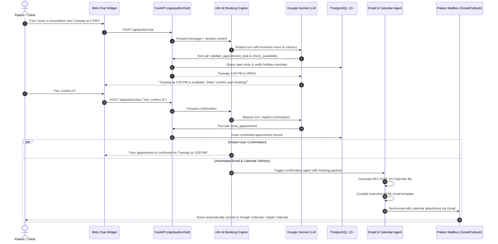
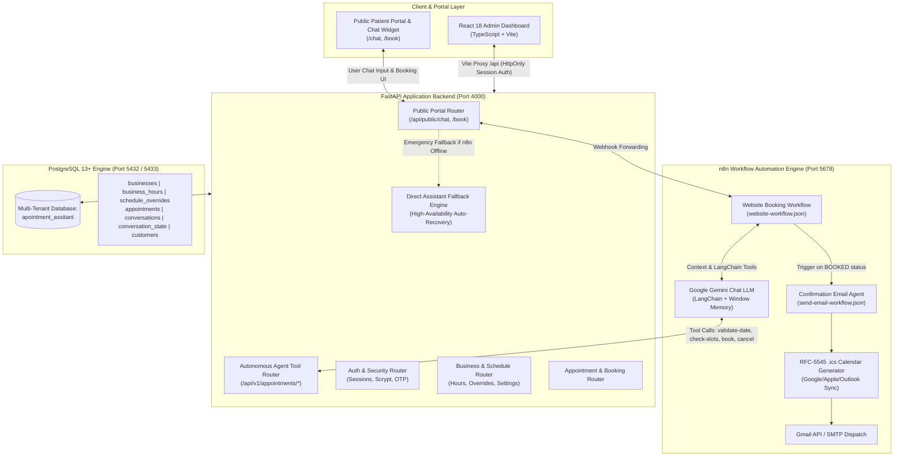

# AI Appointment Assistant — Multi-Tenant Dashboard & Automation Engine

[](https://fastapi.tiangolo.com/)
[](https://react.dev/)
[](https://www.typescriptlang.org/)
[](https://www.postgresql.org/)
[](https://n8n.io/)
[](https://ai.google.dev/)
[](https://vitejs.dev/)
[](LICENSE)

---

### The Problem It Solves
Clinics and service businesses lose up to 40% of potential appointments due to unanswered calls after hours, slow manual messaging, and accidental double-booking. Reception staff spend hours on repetitive scheduling calls instead of attending to in-person clients. This platform automates the entire appointment booking and confirmation lifecycle 24/7 without requiring human staff.

### How It Solves It
Patients converse naturally with an autonomous AI Agent (powered by Google Gemini & n8n) directly on the clinic's website. The agent validates real-time doctor availability against PostgreSQL, books conflict-free slots, and instantly triggers an automated workflow that generates an RFC-5545 `.ics` calendar invitation and delivers a branded confirmation email via Gmail.

---

### Quick Summary: What It Has Done & What It Does
*(For readers who want a fast, clear overview without diving into the full technical specifications)*

- **What It Has Done (The Foundation)**:
  - **Multi-Tenant Database**: Created an enterprise PostgreSQL data model with strict tenant isolation, dynamic business hours, and holiday overrides.
  - **FastAPI Async Backend**: Developed high-throughput REST APIs for appointments, customer profiles, and session security.
  - **Admin Clinic Dashboard**: Built a responsive React 18 + TypeScript web dashboard for clinic owners to manage bookings and operational rules.
- **What It Is Doing (The Active Automation)**:
  - **Conversational Web Booking**: Engages clients in natural dialogue on the website to identify needs, suggest valid dates, and select open time slots.
  - **Autonomous Tool Execution**: Invokes backend verification tools to prevent past dates, off-hours bookings, and schedule conflicts.
  - **Instant Calendar & Email Dispatch**: Builds dynamic calendar files (`.ics`) for 1-click addition to Google Calendar, Apple Calendar, and Outlook, sending executive HTML confirmations automatically.
  - **Fail-Safe Fallback**: Includes a built-in assistant engine that keeps booking operational even if external AI or workflow services experience temporary downtime.

> [!NOTE]
> **Evolution Note:** The platform is laser-focused on a frictionless **Website Chat Booking Portal** with **Direct Email & Calendar (.ics) Synchronization**, ensuring zero third-party messaging costs and guaranteed calendar delivery.

---

## Table of Contents

- [Quick Start (Docker Compose)](#quick-start-docker-compose)
- [How the Automation Works](#how-the-automation-works)
  - [1. Conversational Booking AI Workflow](#1-conversational-booking-ai-workflow)
  - [2. Confirmation Email & Calendar Agent](#2-confirmation-email--calendar-agent)
  - [3. Dual-Engine Resilience](#3-dual-engine-resilience)
- [System Architecture](#system-architecture)
- [Local Development Setup](#local-development-setup)
- [API Surface & Endpoints](#api-surface--endpoints)
- [Author](#author)

---

## Quick Start (Docker Compose)

Get the entire stack (FastAPI Backend, React Frontend, PostgreSQL, and n8n Automation Engine) running in under 2 minutes:

```bash
# Clone the repository
git clone https://github.com/Umair-Nawaz0/appointment-assistant.git
cd appointment-assistant

# Start all services
docker compose up -d --build
```

**Live Local URLs:**
- 🌐 **Patient Web Chat Portal**: [http://localhost:5173/chat](http://localhost:5173/chat)
- 📊 **Admin Dashboard**: [http://localhost:5173](http://localhost:5173) (Demo: `owner@example.com` / `Password123!`)
- 🔌 **FastAPI Swagger API Docs**: [http://localhost:4000/docs](http://localhost:4000/docs)
- ⚙️ **n8n Automation Studio**: [http://localhost:5678](http://localhost:5678)

---

## How the Automation Works

The platform operates an autonomous **two-stage automation pipeline** in n8n connected to FastAPI tools and PostgreSQL:



### 1. Conversational Booking AI Workflow ([`workflow/website-workflow.json`](workflow/website-workflow.json))
- **Webhook Ingestion**: Captures incoming messages with conversation and customer context.
- **Dynamic Context Loading**: Fetches the tenant's operating hours, timezone, holidays, and booking rules.
- **Autonomous Tool Calling**: Gemini uses FastAPI tool endpoints (`validate-date`, `check-availability`, `book-appointment`, `cancel-appointment`) to guarantee factual responses.
- **Deterministic State Tracking**: Updates structured progress in `conversation_state` (`WAITING_FOR_DATE`, `WAITING_FOR_SLOT`, `WAITING_FOR_CONFIRMATION`, `BOOKED`, `CANCELLED`).
- **Sub-Workflow Dispatch**: When status reaches `BOOKED`, it automatically triggers the email agent.

### 2. Confirmation Email & Calendar Agent ([`workflow/send-email-workflow.json`](workflow/send-email-workflow.json))
- **RFC-5545 `.ics` Generator**: Dynamically crafts a compliant calendar invite with exact start/end UTC timestamps, clinic location, and unique UID.
- **Branded HTML Template**: Renders an executive email detailing clinic address, doctor notes, and preparation instructions.
- **Gmail Integration**: Delivers the confirmation directly to the patient's inbox with the `.ics` file attached.

### 3. Dual-Engine Resilience
If n8n or the AI service ever experiences network timeouts or downtime, [`backend/app/routers/public.py`](backend/app/routers/public.py) immediately activates a **built-in direct assistant engine**. It executes database slot checks and books appointments natively so no patient request is lost.

---

## System Architecture



---

## Local Development Setup

### 1. Database Setup
```bash
# Create PostgreSQL database
createdb apointment_assitant

# Load authoritative schema
psql -d apointment_assitant -f database/schema.sql

# (Optional) Load sample demo data
psql -d apointment_assitant -f database/seed.sql
```

### 2. Environment Configuration
```bash
cp .env.example .env
```

### 3. Backend Setup
```bash
python3 -m venv backend/.venv
source backend/.venv/bin/activate
pip install -r backend/requirements.txt
```

### 4. Frontend & Run
```bash
npm install
npm run dev
```

---

## API Surface & Endpoints

| Category | Method | Endpoint | Description |
| :--- | :---: | :--- | :--- |
| **Public Portal** | `POST` | `/api/public/chat` | Patient chat endpoint routing to n8n AI agent with local fallback |
| **Public Portal** | `GET` | `/api/public/clinic-info` | Fetch business hours, address, and booking policy |
| **Public Portal** | `POST` | `/api/public/book` | Direct appointment reservation |
| **AI Agent Tools** | `GET` | `/api/v1/appointments/validate-date` | Verify date against business days and holiday closures |
| **AI Agent Tools** | `GET` | `/api/v1/appointments/check-availability` | Calculate real-time available time slots |
| **AI Agent Tools** | `POST` | `/api/v1/appointments/book` | Atomically reserve slot and commit appointment |
| **AI Agent Tools** | `POST` | `/api/v1/appointments/cancel` | Cancel active appointment with reason tracking |
| **Admin Auth** | `POST` | `/api/auth/login` | Authenticate tenant & issue HttpOnly session cookie |
| **Admin Business** | `GET/PUT` | `/api/business/hours` | Configure weekly operational hours schedule |
| **Admin Appointments**| `GET` | `/api/appointments` | List and filter clinic appointments |

---

## Author

**Umair Nawaz**  
- GitHub: [@Umair-Nawaz0](https://github.com/Umair-Nawaz0)
